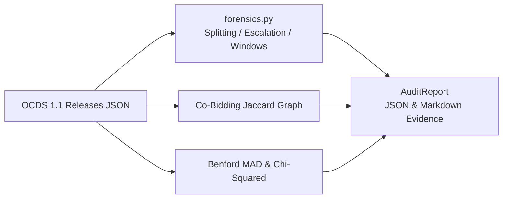

# civicaudit

[](https://github.com/codesphere-u/civicaudit/actions/workflows/ci.yml)
[](LICENSE)
[](pyproject.toml)
[](pyproject.toml)

**Deterministic Open Contracting Data Standard (OCDS 1.1) public procurement forensic auditor: threshold contract-splitting, single-bidder concentration, collusion graphs, and Benford's Law MAD/Chi-Squared testing.**

- **Mission Domain:** Governance, Transparency & Public Services
- **Stack:** Pure Python 3.11+ (zero runtime third-party dependencies, `mypy --strict`, `ruff`, `pytest`)
- **Maintainer:** Codesphere Innovations (U) Limited (`codesphere-u`)

---

## Problem Solved

Most OCDS tools validate JSON schema syntax but leave auditors-general, journalists, and civic watchdogs without a deterministic, zero-dependency engine to surface structural procurement red flags with reproducible evidence.

## Key Features

- `CIVIC-001` Rolling-window threshold contract-splitting detector identifying clustered just-below-threshold awards to the same supplier.
- `CIVIC-002` Single-bidder competitive tender award detector & `CIVIC-003` compressed open-tender submission window detector.
- `CIVIC-004` Post-award contract price escalation creep detector.
- `CIVIC-005` Bipartite Jaccard co-bidding & alternating-win bid-rotation collusion graph analyzer.
- `CIVIC-006` Benford's Law first-digit Nigrini Mean Absolute Deviation (MAD) & Pearson Chi-Squared (`df=8`) conformity test.

## Architecture Overview



See [docs/architecture.md](docs/architecture.md) for module-level design details.

## Installation

```bash
git clone https://github.com/codesphere-u/civicaudit.git
cd civicaudit
uv sync --extra dev
```

Or install in editable mode with standard `pip`:

```bash
pip install -e ".[dev]"
```

## Quick Start (CLI)

```bash
civicaudit demo --format markdown
civicaudit audit ocds_releases.json --threshold 50000 --format json
```

## Quick Start (Python API)

```python
from civicaudit import audit_ocds_releases, evaluate_benford

benford = evaluate_benford([10.0 ** (i / 100.0) for i in range(300)])
assert benford.conformity in ("close", "acceptable")
```

## Testing & Quality Gates

```bash
uv run ruff check src tests
uv run mypy src
uv run pytest -v
```

## Security, Contributing & Roadmap

- **Security:** See [SECURITY.md](SECURITY.md) for responsible disclosure procedures.
- **Contributing:** See [CONTRIBUTING.md](CONTRIBUTING.md) and [CODE_OF_CONDUCT.md](CODE_OF_CONDUCT.md).
- **Changelog & Roadmap:** See [CHANGELOG.md](CHANGELOG.md) and [ROADMAP.md](ROADMAP.md).

## License

MIT License — see [LICENSE](LICENSE).

## Support & Contact

Open an issue on [GitHub Issues](https://github.com/codesphere-u/civicaudit/issues) or contact `codesphereinnovationz@gmail.com`.
